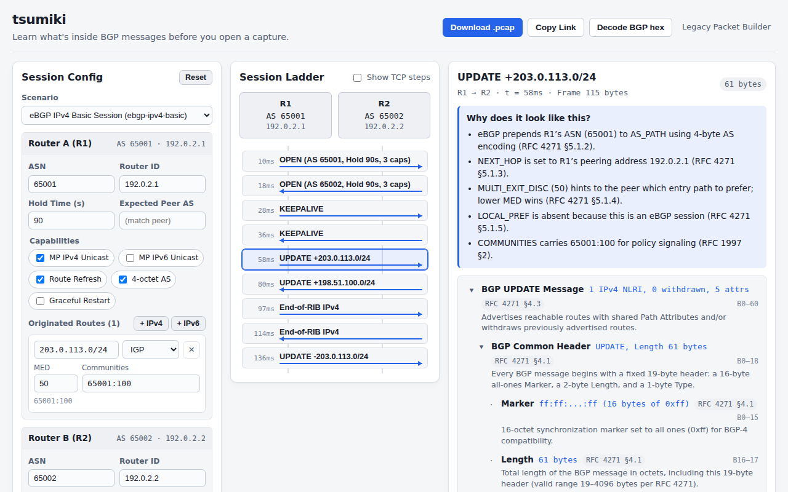

# tsumiki

Learn what's inside BGP messages — OPEN capabilities, UPDATE attributes, End-of-RIB, NOTIFICATIONs — before you open your first capture.

**Live app:** https://shmuto.github.io/packet-builder/



Everything runs purely in the browser (no backend, no telemetry) and deploys as a static site on GitHub Pages. Looking for the previous general-purpose packet builder? It remains available at [`/legacy/`](https://shmuto.github.io/packet-builder/legacy/).

## Features

- **Interactive Session Ladder**: Inspect a live two-router BGP session from TCP port 179 handshake through OPEN capability negotiation, KEEPALIVEs, UPDATE route advertisements/withdrawals, End-of-RIB markers, and NOTIFICATIONs.
- **Wireshark-Style Dissection Tree with Plain-English Explanations**: Every field shows its decoded value, a beginner-friendly explanation, and an RFC section reference — plus a **"Why does it look like this?"** summary explaining session-level rules (e.g., why `LOCAL_PREF` is omitted on eBGP or why `My AS` becomes `23456` `AS_TRANS`).
- **Live Config Panel & Negotiated State**: Change Router A / B ASNs, Hold Times, capability toggles (`MP IPv4`, `MP IPv6`, `Route Refresh`, `4-octet AS`, `Graceful Restart`), originated routes, or session events and see the wire messages and negotiated capabilities update immediately.
- **Bytes on Demand**: Expand the collapsed **Bytes** section on any message for a hexadecimal/ASCII dump with bidirectional tree ↔ byte highlighting.
- **Standalone Raw BGP Hex Decoder**: Paste raw BGP bytes from router logs, captures, or NOTIFICATION data (with a 4-octet AS toggle) to dissect them without setting up a session.
- **Shareable Session Links (`#s1=`)**: Copy a link preserving the scenario, router configs, and events in the URL fragment (old `#p1=` links automatically surface a notice linking to `/legacy/`).

## How to Use It with Wireshark

1. Open the [live app](https://shmuto.github.io/packet-builder/) and pick a scenario or edit Router A / B settings (for example, toggle **4-octet AS** or **MP IPv6 Unicast**).
2. Click **Download .pcap** in the top toolbar to export the entire multi-packet TCP + BGP session with synthetic timestamps.
3. Open the downloaded `.pcap` file in Wireshark (or run `tshark -r tsumiki-ebgp-ipv4-basic.pcap -Y bgp -V`) and compare Wireshark's protocol tree side-by-side with tsumiki's explanations.

Every built-in scenario is verified in CI against Wireshark's own `tshark` dissector (`npm run oracle`) with checksum verification enabled and zero expert errors.

## Local Development

Requires Node.js 22+.

```bash
npm install
npm run dev                     # Start Vite dev server
npm run check                   # Run typecheck, dead-code check, Vitest unit tests, and Vite build
npm run oracle                  # Verify exported session pcaps against tshark (requires tshark)
npm run e2e                     # Run Playwright E2E tests (including /legacy/)
PW_CHANNEL=chrome npm run e2e   # Run Playwright E2E tests using system Chrome
```

## Project Structure

- `src/core/bgp/` — Standalone, DOM-free BGP-4 message model, encoder, raw hex stream decoder, and dissection tree builder (OPEN capabilities, UPDATE path attributes, MP-BGP IPv6, 4-octet AS / `AS4_PATH`, ADD-PATH, End-of-RIB, NOTIFICATIONs, ROUTE-REFRESH)
- `src/core/session/` — Pure two-router BGP session simulator (`buildSession`, `exportSessionPcap`), built-in scenarios, and `#s1=` permalink codec
- `src/core/layers/` — Ethernet II, IPv4, IPv6, and TCP (with MSS options) transport framing plumbing
- `src/core/` — Shared byte utilities (`bytes.ts`), RFC 1071 checksums (`checksum.ts`), `Result<T>` (`result.ts`), and multi-packet libpcap writer (`pcap.ts`)
- `src/ui/bgp/` — React UI components (`ConfigPanel`, `SessionLadder`, `BgpMessageInspector`, `NegotiatedStatePanel`, `DecodeBgpHexPanel`)
- `scripts/` — `wireshark-oracle.mjs` (tshark verification), `check-unused-files.mjs` (dead-code check), `ensure-legacy-dist.mjs` (`/legacy/` builder preservation)

## CI & Deployment

| Workflow | Purpose |
| --- | --- |
| `.github/workflows/ci.yml` | Runs `check`, `e2e` (including `/legacy/`), and `wireshark-oracle` (`tshark`) on PRs and pushes to `main` |
| `.github/workflows/pages.yml` | Builds the BGP app to `dist/` and commit `ffbcf65` to `dist/legacy/`, then deploys to GitHub Pages |
| `.github/workflows/claude-review.yml` | Runs automated PR code reviews |
